# Gryphon Manager manual

Version 2.0.0. Leeds Gryphon Racing, FS27.

Gryphon Manager is the one laptop app for the car's data. It shows what's on the CAN bus, what the DAQ radios to the pits, records and replays runs, walks you through a car test, edits the list of sensors, changes the DAQ's settings and flashes its firmware. The aim is that nobody on the team needs VS Code, a serial terminal or SavvyCAN for normal work.

On the car's bus the app only listens, unless someone switches on "Allow transmit" in Settings.

One thing to know before anything else: the v2 DAQ firmware and the FS27 receiver firmware have been built and desk-tested, but at the time of writing they have not been run on the real boards. Flash them on the bench first and keep the fallback files to hand (see Flashing).

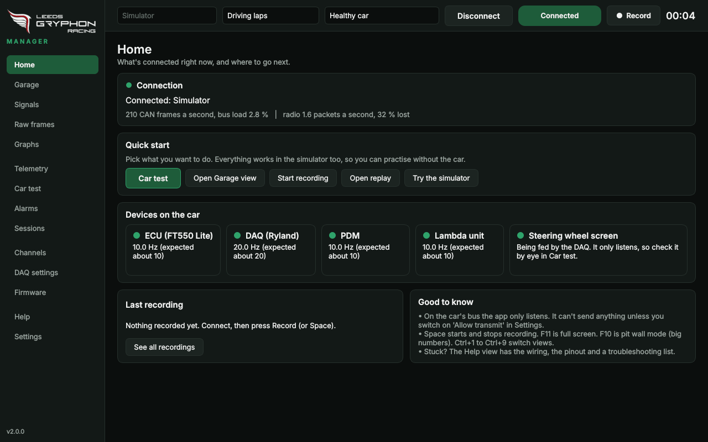

## 1. Next year's team, start here

If you've just inherited the DAQ, do these in order. It takes about an hour.

1. Install the app (section 2) and open it. Pick Simulator in the top bar and press Connect. Click through every view on the left. Nothing you do in the simulator can touch the car.
2. Read section 4 once, so you know what each view is for.
3. Plug the PEAK PCAN-USB into the debug port C41 on the car, pick "Car (CAN cable)", Connect, and open Garage. Every device should have a green light.
4. Run the Car test view from start to finish with someone who knows the car. It saves a report you can keep.
5. Read "Adding a sensor" (section 6) before you touch the firmware. Most year-to-year changes are now settings the app sends, with no rebuild.

Where things live:

| Thing | Where |
| --- | --- |
| The app's code | `manager/` in the FS27-DAQ repo, branch `gryphon-manager` |
| DAQ firmware | The repo's top folder. Files with `_fs27` in the name are the FS27 versions of Louis's FS26 files |
| Receiver firmware | `receiver/` (Louis's FS26-RCV with one change, see its README) |
| The sensor list | `manager/config/channels.yaml`, edited with the Channels view |
| Protocol write-ups | `wiki/DAQ-Settings-Protocol.md`, `wiki/Receiver-PKT-Format.md` |
| Your recordings, reports, settings | `Documents\Gryphon Manager` on your laptop |
| Releases (app zip and firmware) | The repo's Releases page on GitHub |

The names you'll hear: the DAQ is "Ryland", the pit receiver is "Rocky", the ECU is a FuelTech FT550 Lite.

To change the app itself: `cd manager`, `pip install -r requirements-dev.txt`, `python run.py`. Run `python -m pytest` before you push. Every push to `gryphon-manager` is tested and built by GitHub Actions, and a tag like `manager-v2.0.0` makes a release.

## 2. Installing

### Windows

1. Install the PEAK driver. Get "Device driver setup for Windows" from <https://www.peak-system.com/support/downloads/drivers/driver-packages/> and run it. Leave PCAN-Basic ticked.
2. Download `GryphonManager-windows.zip` from the repo's Releases page.
3. Unzip it anywhere and double-click `GryphonManager.exe` inside the `GryphonManager` folder. No Python needed.
4. The first time, Windows may say "Windows protected your PC". Click More info, then Run anyway.

### Windows on a Mac (Parallels, Apple Silicon)

This is Windows 11 on ARM, and it works.

1. Install the same PEAK driver inside Windows. It covers ARM.
2. Plug in the PCAN-USB. Parallels asks where to connect it: choose Windows. If it doesn't ask, use the Parallels menu: Devices > USB & Bluetooth > PCAN-USB.
3. Do the same for the DAQ's USB cable and the receiver when you use them. A device can only belong to the Mac or to Windows at one time, so if the app can't see it, check that menu first.
4. For flashing, the Pico's RP2350 drive also has to be given to Windows the same way.

### From source (any system)

```
cd manager
python -m venv .venv
.venv\Scripts\activate        (Windows)    source .venv/bin/activate   (Mac, Linux)
pip install -r requirements-dev.txt
python run.py
```

Python 3.12. The simulator, replay, the receiver and the DAQ over USB work on any system. The PCAN-USB on a Mac without Parallels needs the MacCAN PCBUSB library, which hasn't been tested.

## 3. Connecting

Pick a source in the top bar, then press Connect. The same views work with every source.

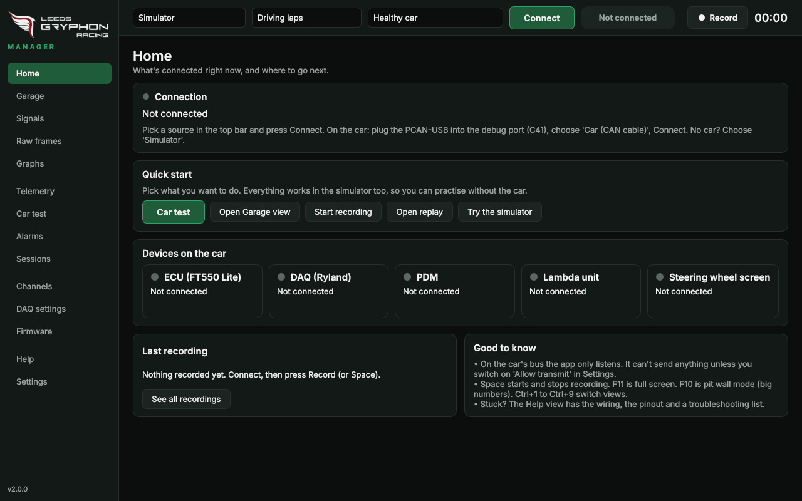

| Source | What you plug in | What you get |
| --- | --- | --- |
| Car (CAN cable) | PEAK PCAN-USB into the debug port C41 | Everything on the bus: ECU, DAQ, PDM, lambda, screen |
| Radio (pit receiver) | The receiver's USB cable | What the DAQ radios to the pits, with signal strength |
| DAQ over USB | The DAQ's own USB cable | The DAQ's debug lines, and its settings |
| Simulator | Nothing | A pretend car with switchable faults |
| Replay | Nothing | A recording, played back through every view (start it from Sessions) |

Car (CAN cable). Plug the adapter into C41 with the car's power on. The adapter is opened listen-only, so the app can't disturb the bus. If nothing appears, look at the bus health box in Garage.

Radio. Plug in the receiver and pick its port from the list next to the source. The app reads both kinds of receiver output: the old FS26 text box and the new one-line `PKT` format from the FS27 receiver firmware.

DAQ over USB. Plug in the DAQ and pick its port. You'll see the `[TX]`, `[ECU]`, `[GPS]` and `[CAN]` lines decoded in Garage. This is also the only connection that can change DAQ settings.

Simulator. Choose what the pretend car is doing (driving laps, idling, ignition on with engine off) and a fault to inject (ECU at 1 Hz, low oil pressure, DAQ sending wrong values, bus errors, and so on). The simulator also answers the DAQ settings protocol the same way the real firmware does, so you can practise sending settings.

If a cable gets pulled out, the app says so, keeps any recording safe and reconnects by itself when the cable is back.

## 4. The views

### Home

What's connected, a light for each device, and quick buttons for the things people do most.

### Garage

The view for testing on the car with the CAN cable. Big live values, a light for each device with its measured rate against the expected rate, bus health, and a check that the DAQ's screen frames (0x600 to 0x603) agree with what the ECU is sending.

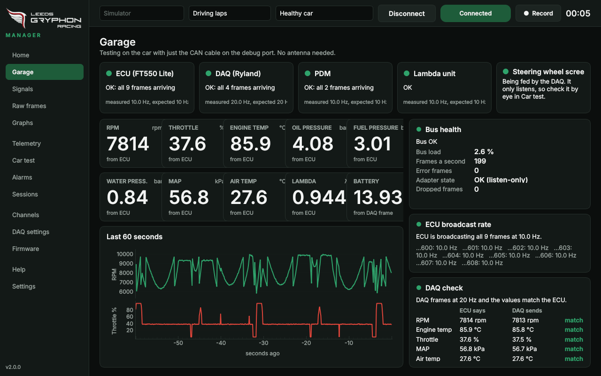

It also warns about the known FT550 problem where the ECU broadcasts at about 1 Hz instead of 10 Hz:

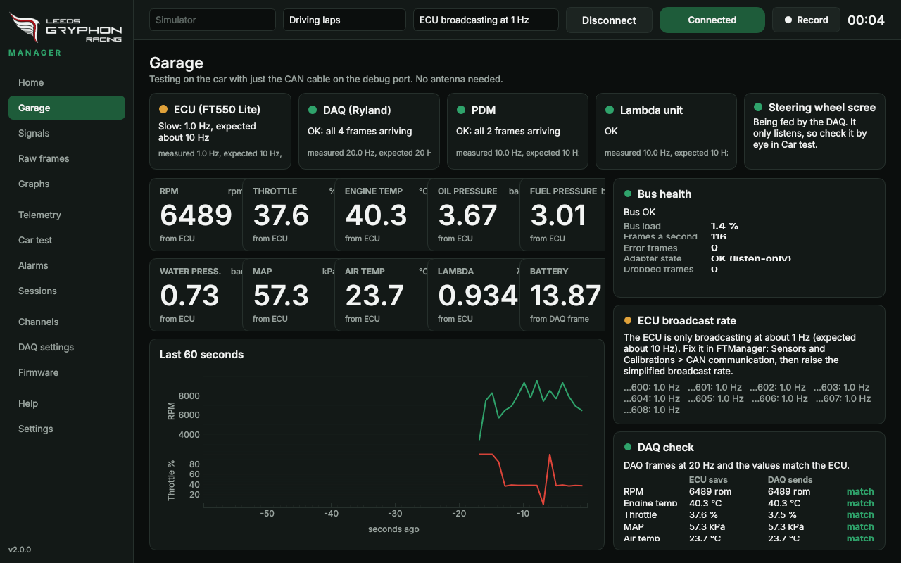

### Signals

Every decoded value in one table, with its minimum, maximum, update rate and which CAN ID it came from.

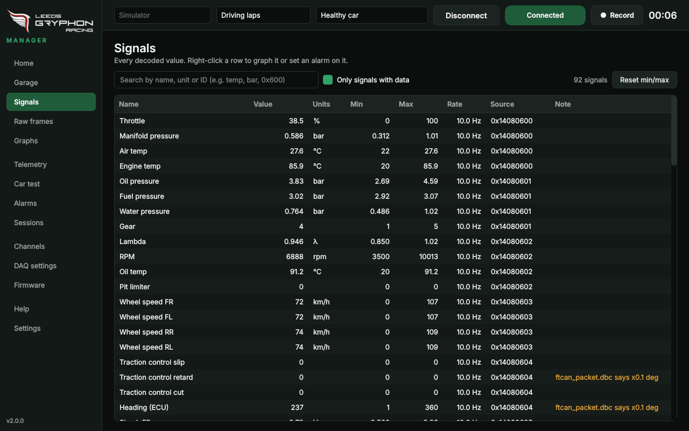

### Raw frames

Every CAN ID on the bus, like PCAN-View. Bytes that just changed are highlighted, and IDs the app doesn't know are shown in amber.

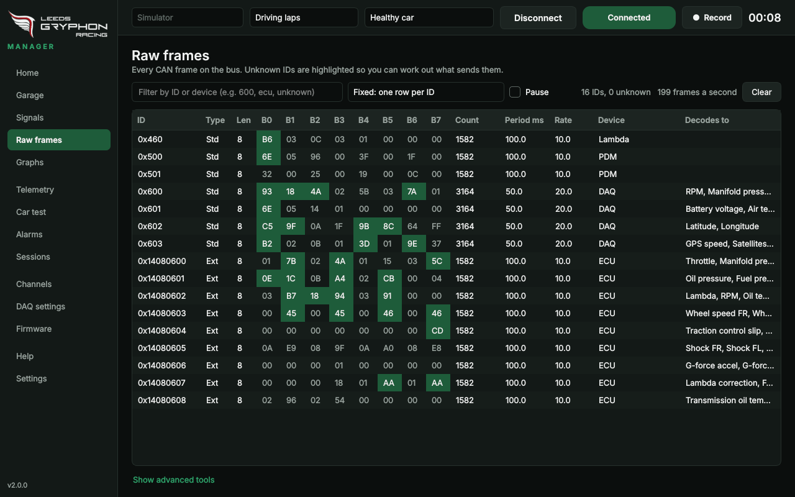

### Graphs

Live plots of any values. Pause, drag a cursor, zoom, save as a PNG.

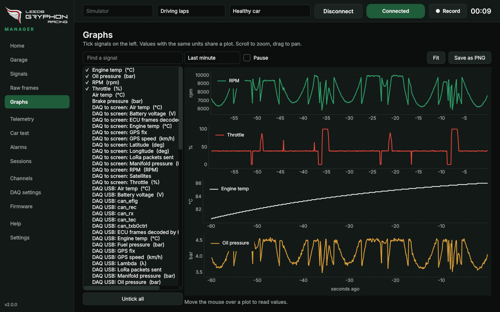

### Telemetry

For the pits. Radio values as tiles, a GPS track map coloured by speed that works offline, marks where the signal dropped, lap timing and link quality.

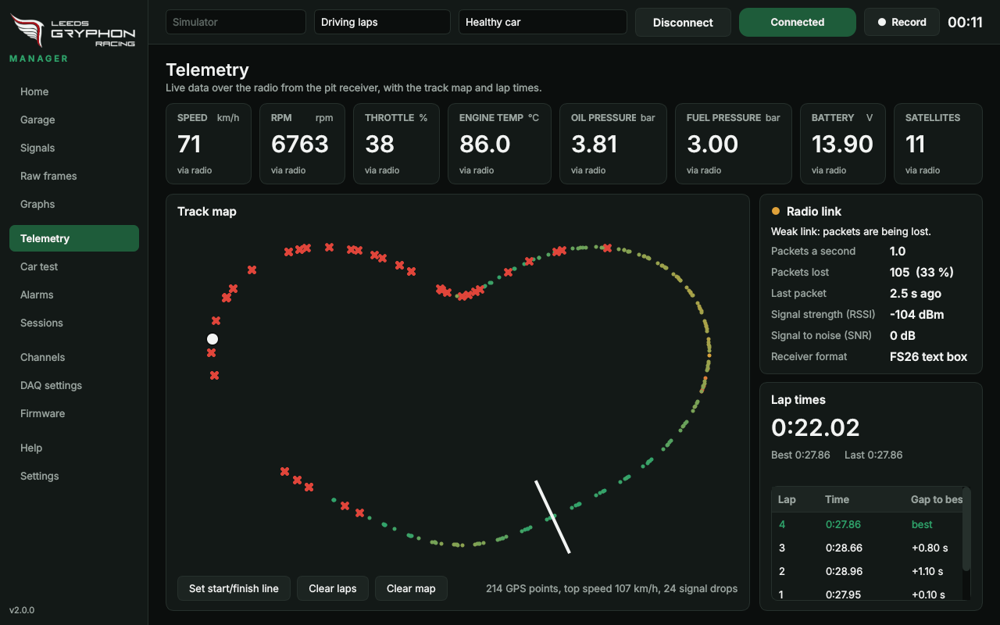

### Car test

See section 5.

### Alarms

Rules such as "oil pressure below 1 bar while RPM is above 2000". When one trips you get a red banner across the app and, if you want, a sound. You can add, edit and switch off rules here.

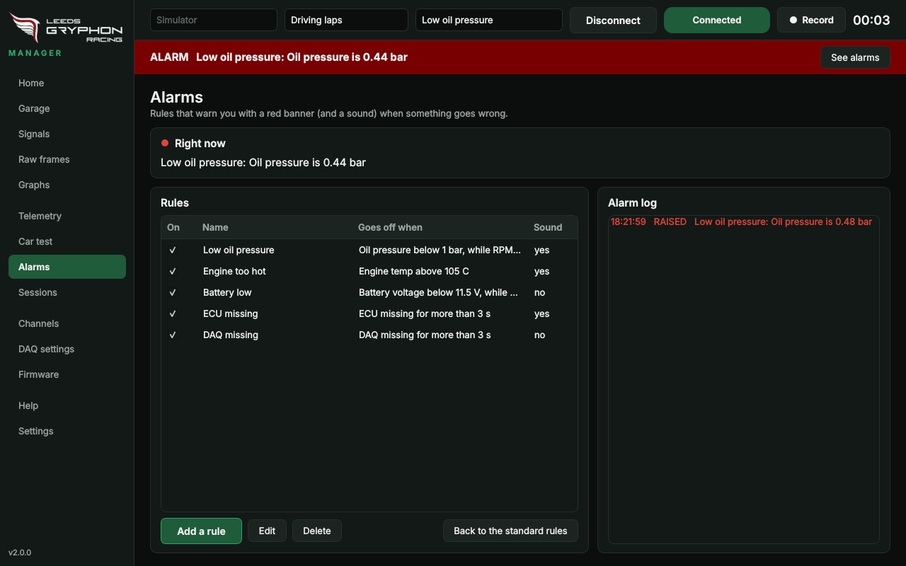

### Sessions

Your recordings. Press Space anywhere to start or stop recording. Here you can replay a session at 0.5x to 8x, jump to an alarm, see min/max/average, overlay two sessions or two laps, and export a CSV for Excel.

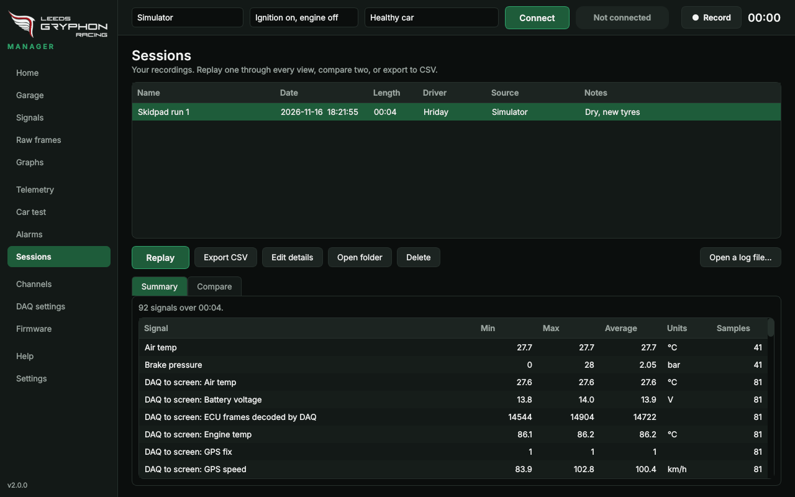

### Channels

The master list of sensors. See section 6.

### DAQ settings

See section 7.

### Firmware

See section 8.

### Help

The built-in start-here guide and the first car test checklist. F1 opens it.

### Settings

Adapter, device IDs, units, text size, recording options, update check, and the "Allow transmit" switch (leave it off).

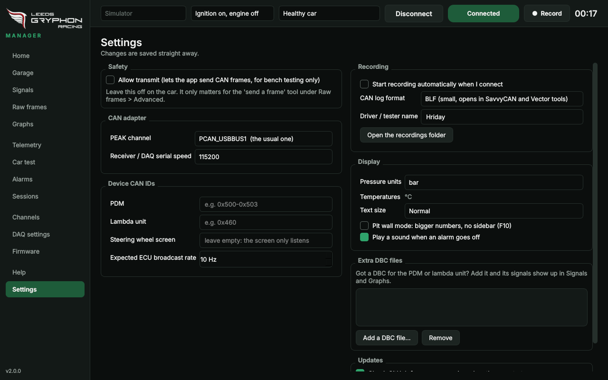

Keys: Space record, F11 full screen, F10 pit wall mode (big text for a screen on the pit wall), F1 help, Ctrl+1 to Ctrl+9 switch views.

## 5. The car test

Car test is a guided check with seven steps: bus resistance with a multimeter, connection and bus health, engine off, the DAQ's frames, the steering wheel screen, engine running, and a comparison with FTManager. Each step tells you what to do, shows the live values it's judging, and lets you mark pass or fail with a note.

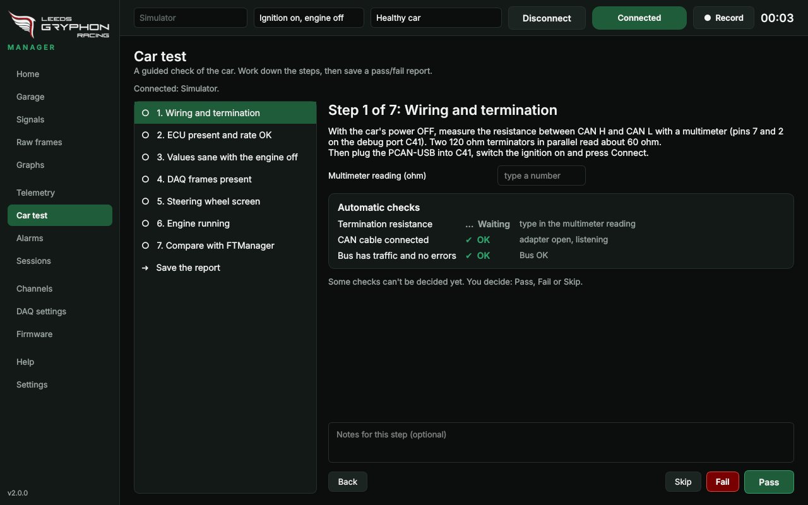

1. Connect with the CAN cable first.
2. Work through the steps in order. You can go back.
3. At the end, put your name in and press Save. You get an HTML and a PDF report plus the raw log, in `Documents\Gryphon Manager`.

Do this after any wiring change, any firmware flash, and before each event.

## 6. Adding a sensor

All of this is done in the Channels view. It has three tabs: the channels, the steering wheel screen frames, and the radio packet.

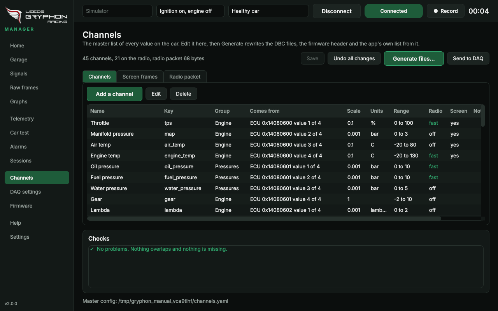

### A sensor the ECU already sends

1. Add a channel. For "Comes from" choose "ECU frame (FT550)", then the frame and which of its four values it is.
2. Set the scale, units and expected range.
3. If it should go to the steering wheel screen, add it on the Screen frames tab. If it should go to the pits, add it on the Radio packet tab.
4. Press Send to DAQ (section 7 explains what that does).

### A sensor wired to a spare input on the DAQ

The DAQ has fifteen spare inputs:

| Input | Where | Reads |
| --- | --- | --- |
| A0, A1, A2 | Pico pins GP26, GP27, GP28 | 0 to 3.3 V |
| X0 to X3 | ADS1115 board at address 0x48 | 0 to 5 V |
| X4 to X7 | ADS1115 board at address 0x49 | 0 to 5 V |
| F0 to F3 | Pico pins GP16, GP17, GP18, GP20 | Pulses (Hz) |

The two ADS1115 boards go on I2C: SDA on GP2, SCL on GP3. They're optional. If a board isn't fitted, its inputs read zero, the DAQ settings page says "board not fitted", and everything else carries on.

Wiring warning: the Pico's pins are 3.3 V only. A0 to A2 must never see more than 3.3 V, so a 5 V sensor needs a divider or one of the X inputs. The I2C pull-ups must go to 3.3 V even when an ADS1115 is powered from 5 V. Check this with whoever does the wiring before fitting a board.

1. Add a channel. For "Comes from" choose "Spare input on the DAQ" and pick the input.
2. Pick the sensor type and fill in its numbers:

| Sensor type | Numbers it asks for | Example |
| --- | --- | --- |
| 0-5 V sensor (straight line) | Volts and value at each end, and the divider if there is one | 0.5 V = 0 bar, 4.5 V = 160 bar |
| Thermistor (NTC to ground) | Pull-up resistor, resistance at 25 C, beta, pull-up supply | 10k pull-up, 10k NTC, beta 3950, 3.3 V |
| Wheel speed (pulses) | Teeth on the trigger wheel, tyre circumference | 20 teeth, 1.6 m |
| Pulses, scaled | Value per Hz | 3 for a 20-tooth shaft in RPM |
| Raw volts or Hz | Nothing | For checking the wiring |

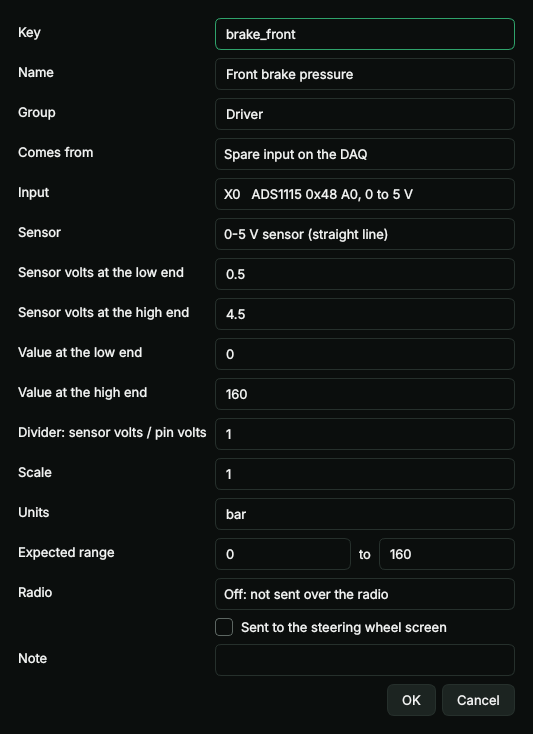

3. Add the channel to a screen frame or the radio packet if you want it there.
4. Press Send to DAQ. Then open DAQ settings to see the input's live value.

A thermistor that's unplugged reads -50 and one that's shorted reads 250, so a broken wire is obvious.

### The screen frames and the radio packet

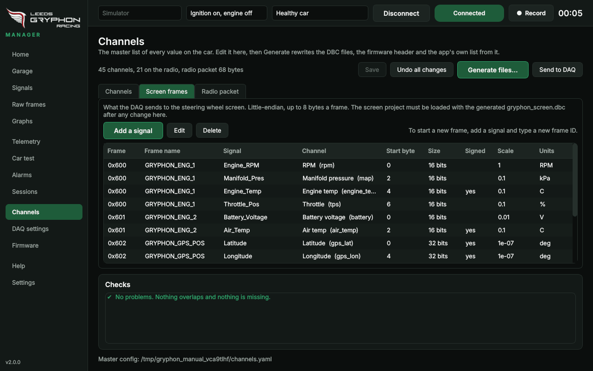

The Screen frames tab is what the DAQ sends to the steering wheel screen: up to 8 frames of 8 bytes. The Radio packet tab is what goes to the pits: up to 48 fields.

The standard radio packet is 68 bytes and every receiver understands it. If you add or remove radio fields, the DAQ sends a different packet marked with a layout version. For that you need the FS27 receiver firmware on the receiver (section 8) and the same channel list on every pit laptop. The app warns you about this before it sends. Changing screen frames or spare inputs doesn't affect the radio.

"Generate files" writes the team DBC, the screen DBC for the Winstar builder and a signal list, and shows you a diff first.

## 7. Changing DAQ settings

This needs the v2 DAQ firmware. With the older firmware the app says "This DAQ has the older firmware", changes nothing, and everything else still works.

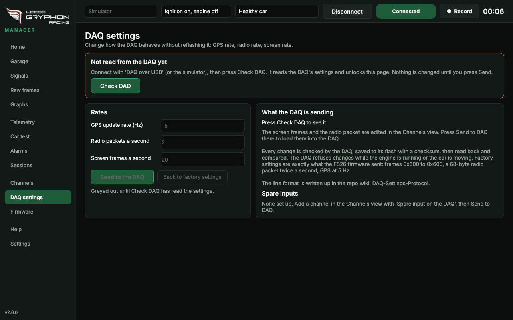

1. Stop the engine. The DAQ refuses changes while the engine is running or the car is moving, and so does the app.
2. Plug in the DAQ's USB cable, choose "DAQ over USB", Connect.
3. Open DAQ settings and press Check DAQ. The page reads what the DAQ is using and unlocks.

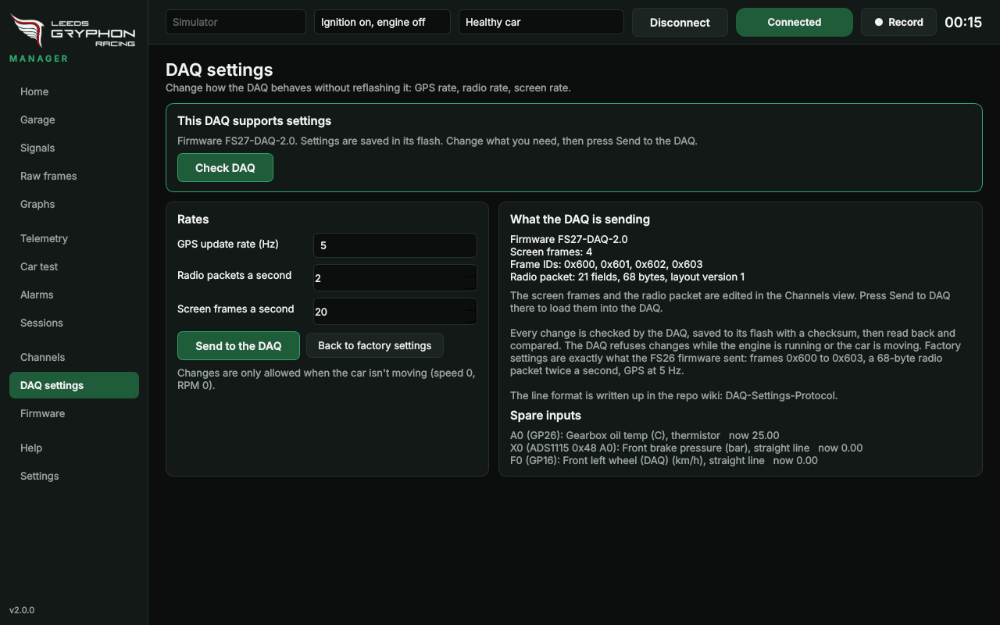

4. Change what you need:

| Setting | Allowed | Factory |
| --- | --- | --- |
| GPS update rate | 1, 5 or 10 Hz | 5 |
| Radio packets a second | 2 to 10 | 2 |
| Screen frames a second | 1 to 50 | 20 |

5. Press "Send to the DAQ". The DAQ checks the values, saves them in its flash memory with a checksum, and the app reads them back and compares. You get a message either way.

Send to DAQ in the Channels view does the same thing for the screen frames, the radio packet and the spare inputs.

"Back to factory settings" puts everything back to exactly what the FS26 firmware did: frames 0x600 to 0x603, the 68-byte radio packet twice a second, GPS at 5 Hz, no spare inputs.

Settings survive power cycles. If the saved settings are ever damaged, the DAQ notices from the checksum and starts on factory settings.

## 8. Flashing firmware

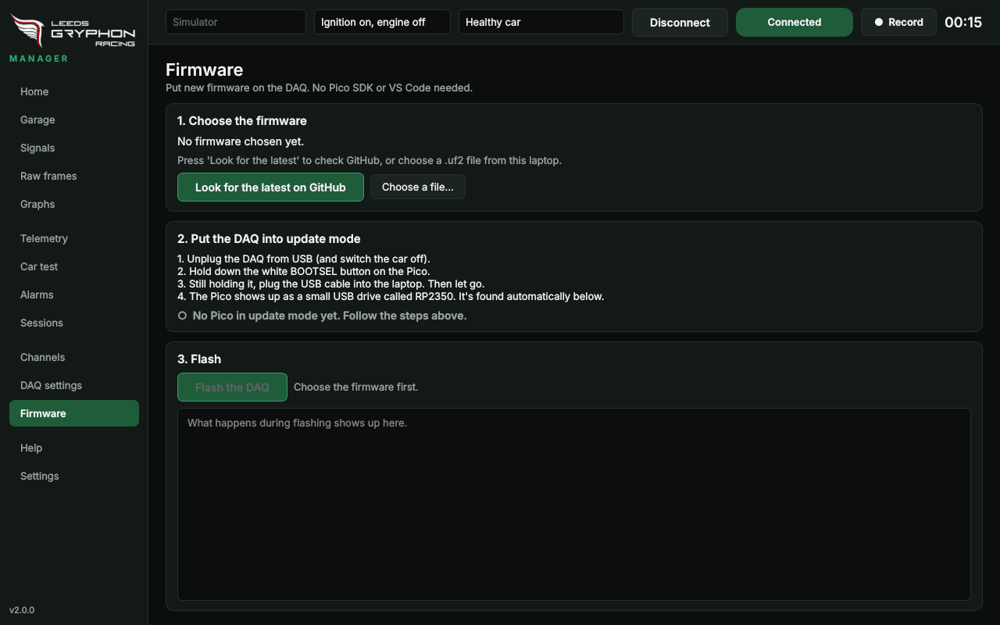

### The DAQ

1. Open Firmware and press "Look for the latest on GitHub". It finds `FS27-DAQ.uf2` in the newest release. Or press "Choose a file" for a `.uf2` you already have.
2. Switch the car off and unplug the DAQ's USB cable.
3. Hold the white BOOTSEL button on the Pico, plug the USB cable in, then let go. The Pico appears as a small drive called RP2350 and the app finds it.
4. Press "Flash the DAQ". The app copies the file and waits for the DAQ to restart.
5. Connect with "DAQ over USB" and press Check DAQ on the DAQ settings page to confirm it answers. Then run the car test.

Each release has three firmware files:

| File | What it is |
| --- | --- |
| `FS27-DAQ.uf2` | DAQ firmware v2: settings, spare inputs. The one the app picks |
| `FS27-DAQ-v1-fallback.uf2` | The DAQ firmware from before settings existed. Flash this with "Choose a file" if v2 misbehaves |
| `FS27-RCV.uf2` | Receiver firmware, FS27 version |

### The receiver

Same BOOTSEL steps on the receiver's Pico, with "Choose a file" and `FS27-RCV.uf2`. It's Louis's FS26 receiver with one change: it passes each packet to the laptop as a `PKT` line. The old `fs26_interface.py` dashboard can't read that format, Gryphon Manager reads both. Louis's original firmware is the fallback.

### First time with the new firmware

Do it on the bench, with the car off the ground or the DAQ out of the car:

1. Flash, connect over USB, Check DAQ.
2. Don't change anything yet. Connect the CAN cable and confirm in Garage that the DAQ still sends 0x600 to 0x603 at 20 a second and that the values match the ECU.
3. Confirm the pits still get radio packets.
4. Only then try a settings change, then a factory reset.

## 9. Troubleshooting

| What you see | What to try |
| --- | --- |
| "Couldn't open" the PCAN-USB | Is the PEAK driver installed? Is PCAN-View or another program using it? In Parallels, is the adapter given to Windows? |
| Connected, but no frames | Car power on? Plugged into C41? Look at bus health in Garage. Measure across CAN high and low with the car off: about 60 ohms means both terminators are there |
| Bus health says errors or "error passive" | Wrong bit rate, a missing terminator or a wiring fault. The adapter is listen-only, so it isn't the cause |
| ECU light amber, about 1 Hz | The known FT550 broadcast problem. Garage explains it. Check the ECU's CAN broadcast setting in FTManager |
| DAQ light red on the CAN cable | The DAQ isn't sending its screen frames. Plug into the DAQ over USB and read its `[CAN]` line |
| DAQ values don't match the ECU | Garage shows which. Usually a screen frame layout that doesn't match what was sent: Send to DAQ again, or factory reset |
| Radio: nothing arriving | Right serial port? Receiver powered? DAQ transmitting (its `[TX]` count going up over USB)? |
| Radio stopped after Send to DAQ | The radio packet was changed and the receiver has the old firmware. Flash `FS27-RCV.uf2`, or factory-reset the DAQ |
| Radio values look wrong after a layout change | The laptop's channel list doesn't match the DAQ's. Use the same `channels.yaml` everywhere |
| "This DAQ has the older firmware" | Flash `FS27-DAQ.uf2`. Nothing was changed |
| "The DAQ said no: the car is moving" | Stop the engine, wait for the wheels to stop, try again |
| "The DAQ said no: ... flash" | Try again. If it repeats, reflash the firmware |
| "read back different values" | The save didn't take. Press Check DAQ to see what it's using, then send again |
| A spare input says "board not fitted" | That ADS1115 isn't answering. Check its power, SDA on GP2, SCL on GP3 and its address |
| A thermistor reads -50 or 250 | -50 is unplugged or a broken wire, 250 is shorted to ground |
| The RP2350 drive doesn't appear | Hold BOOTSEL before plugging in. Use a data cable, not a charge-only one. In Parallels, give the drive to Windows |
| The app crashed | It saves a crash log in `Documents\Gryphon Manager\logs` and keeps your recording. Send the log to whoever looks after the app |
| The screen looks tiny on the pit wall | F10 for pit wall mode, or raise the text size in Settings |

If you're stuck, connect to the Simulator. If the same view works there, the problem is the wiring or the device, not the app.
